# DeadCraft


*There is no morning here.*

DeadCraft is a horror overhaul for **Minecraft 1.21.1 (NeoForge 21.1)**. Fifteen horrors hunt
the dark, five bosses wait in tombs, castles and gateways, and destroyed cities are overrun by
zombies. It adds four dimensions with their own terrain and skies and eight biomes, plus guns, magic, vehicles and a dodge/combo
combat system. The client side is reworked with a blood-soaked title screen, a new HUD, a
cinematic camera, walk/run animations and a full soundscape.


| | |
|---|---|
|  |  |

*Screenshots from the dev client: the crypt title screen with a boss on the altar; Chronos and Fracture at
noon; the Dim Light Demon's boss bar over the vial HUD (half health, so the skull's eyes are lit),
with the 3D Bloodreaver in hand.*

**Bestiary** (rendered by `tools/preview.py` straight from the model geometry and textures):

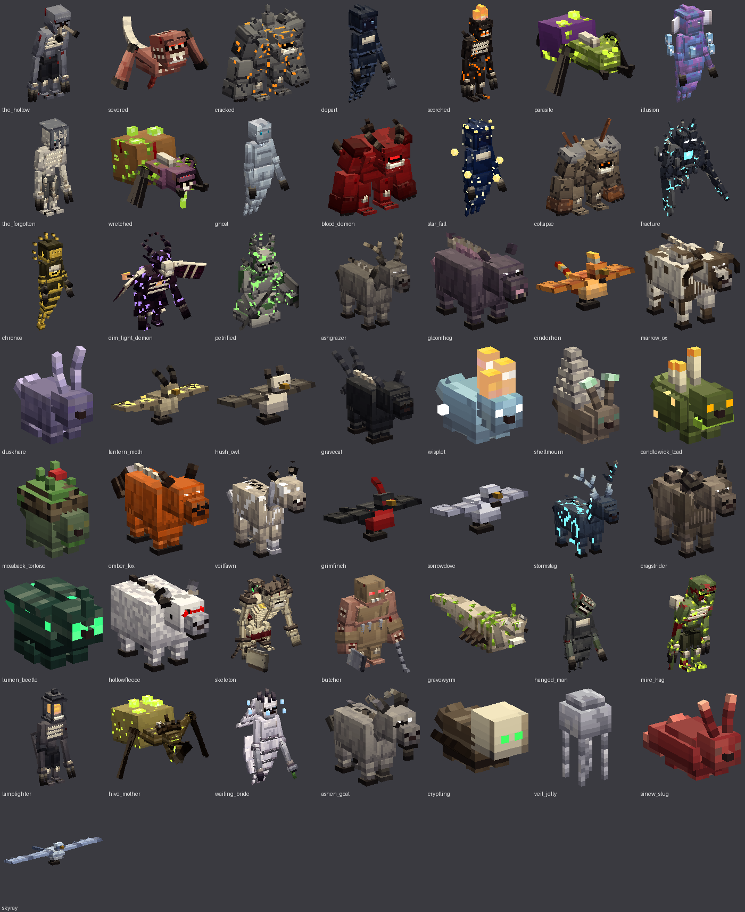
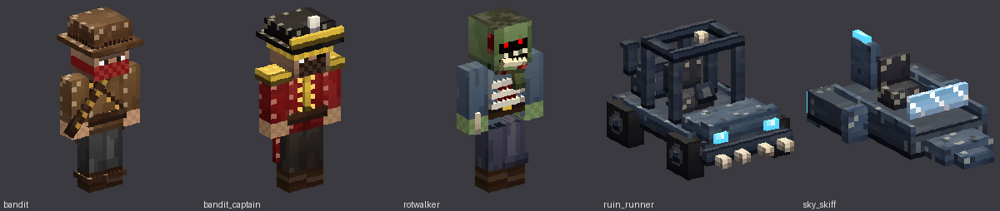
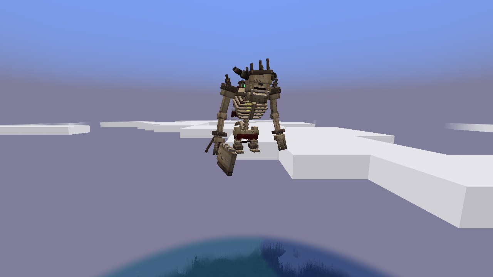

## Build and run

Requirements: JDK 21. Gradle downloads everything else.

```sh
cd deadcraft
./gradlew build          # → build/libs/deadcraft-0.1.0.jar (drop into your mods folder)
./gradlew runClient      # dev client
./gradlew runServer      # dev server (accept the EULA in run/eula.txt first)
```

When you first open a world, Minecraft warns that it uses experimental settings. Vanilla shows
this warning for any world with custom dimensions, and it only appears once per world.

Optional: install **[Simple Voice Chat](https://modrinth.com/plugin/simple-voice-chat)** for
proximity voice chat. DeadCraft detects it automatically, and creatures can then hear you speak.

## Controls

| Action | Default key |
|---|---|
| Dodge (i-frames, direction follows WASD) | Left Alt |
| Reload gun | R |
| Fire gun | Right-click (hold for the SMG) |
| Cast spell | Right-click with a staff, tome, rod or chalice |
| Drive vehicle | Right-click to mount. W/S throttle, A/D steer (Ruin Runner), look to fly (Sky Skiff) |
| Pick up vehicle | Sneak + punch |

## Creatures

**Hostile (20):** The Hollow (only moves when nobody is looking at it), Severed (leaps, causes
bleeding), Cracked (fires shards when struck), Depart (teleports behind you, brings darkness),
Scorched (sets everything nearby on fire), Parasite (fast leaps, infests), Illusion (spawns decoy
copies), Bandit (shoots revolvers), Bandit Captain (shotgun, calls reinforcements), The Forgotten
(hears twice as far, inflicts Dread), Wretched (spits acid), Ghosts (pass through walls, immune to
arrows), Blood Demon (lifesteal, frenzies when hurt), Star Fall (calls down falling stars),
Collapse (ground slam, explodes on death), the Butcher (charges, cleaver hits bleed and slow), the
Gravewyrm (burrows and bursts up beneath you), the Hanged Man (floats with its noose on and drags
you toward it), the Mire Hag (spits poison, calls parasites) and the Lamplighter (a lantern-cage head;
smothers light around it and sets you alight).

**Destroyed-city zombie:** Rotwalker. Unlike vanilla zombies, it doesn't burn in daylight.

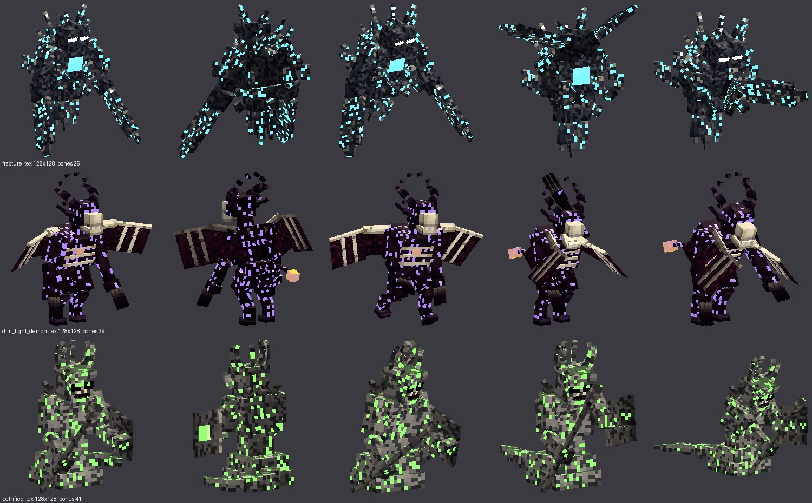

**Bosses (7)**, each with its own model, its own walk and attack animation, a boss bar, a second
phase at half health and its own trophy:
- **Fracture:** a crystal titan hovering over a pedestal of shards, with blade arms that scissor
  shut. Shard novas, ground slams; summons Cracked.
- **Chronos:** glides as its pendulum swings; all four arms sweep like clock hands. A slowing aura, homing time bolts and teleports. Rewinds its own health once.
- **The Skeleton:** the Ossuary Colossus, a hunched giant of yellowed bone. It has a horned skull with an iron crown driven into it, a ribcage caging a brazier of soul fire, shackled wrists trailing broken chains, a cleaver hewn from a giant's jawbone, a cage of souls lashed to its spine and a spiked tail. It fires bone volleys, raises skeleton guards and leaps at you in phase two.
- **Dim Light Demon:** a demon lord on backward-bending legs with vast wings and a four-horned
  goat skull; it flares its wings and rakes with both claws. Darkness pulses, rains hellfire, summons Blood Demons.
- **Petrified:** a gorgon statue with a coiled serpent body, snake hair, a spear and a shield;
  it slithers and thrusts. Looking at it slows you to a crawl. Throws boulders, slams the ground, shrugs off half of all projectile damage.

- **Hive Mother** (new): a crawler queen with a glowing egg sac and scythe forelimbs. Spits acid,
  summons parasites, slams and leaps. Her lair is the Hive Nest in Hell's Paradise.
- **Wailing Bride** (new): a towering spirit in a rotted wedding gown and a trailing veil. Her wail
  hurls you back, weakens and blinds you; she teleports and calls ghosts. Her lair is the Bride's
  Chapel in Skyfall Torn.

Bosses spawn in structures (the castle always has the Skeleton). You can also summon them with
**Sigils** crafted from their materials.

**Peaceful (25):** Ashgrazer, Gloomhog, Cinderhen, Marrow Ox and Duskhare drop meat you can
cook (smelt it, or kill them with fire). Also: Lantern Moth, Hush Owl, Gravecat, Wisplet,
Shellmourn, Candlewick Toad, Mossback Tortoise, Ember Fox, Veilfawn, Grimfinch, Sorrowdove,
Stormstag, Cragstrider, Lumen Beetle, Hollowfleece, Ashen Goat, Cryptling, Veil Jelly, Sinew
Slug and Skyray. Breed them with wheat, seeds, carrots or
berries.

### Hearing and proximity chat
Creatures react to sound through one system (`world/Hearing.java`):
- **Voice** (with Simple Voice Chat): the louder you speak, the further it carries. Whispering is near-silent.
- **Text chat** carries 16 blocks. Sprinting is louder than walking, and sneaking halves every noise you make.
- **Gunshots, engines, explosions and spells** are loud.

A quiet noise sends creatures to investigate. A loud or close one makes them hunt you. The Forgotten hears twice as far.

## World

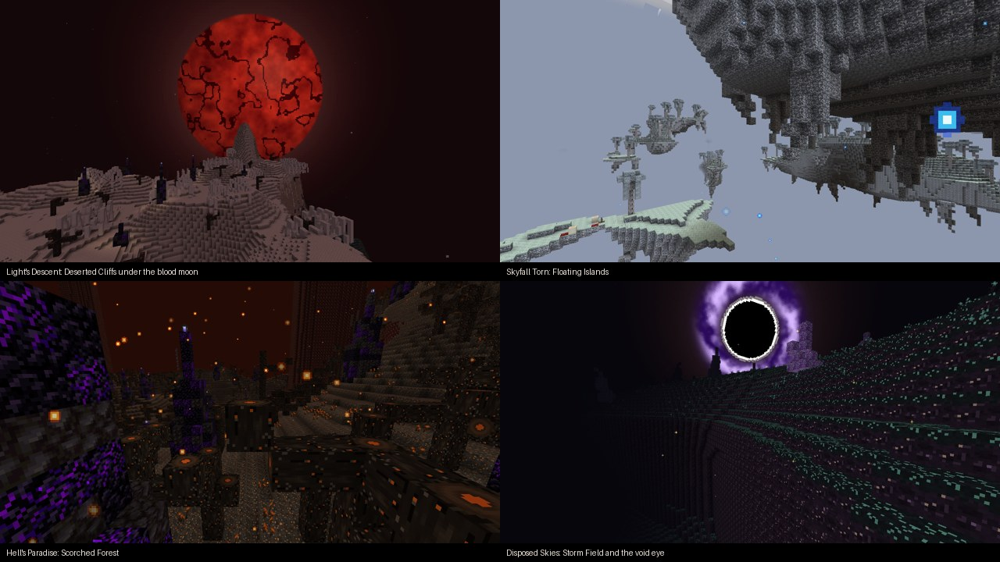

Every DeadCraft dimension has its own terrain generator, blocks, sky and biomes. None of them reuse
vanilla Nether, End or Overworld terrain, and no biome appears in more than one dimension.

| Dimension | Terrain | Sky | Biomes |
|---|---|---|---|
| **Hell's Paradise** | A gutted cavern world of charnel stone: a floor and a roof torn open by vast caverns, column pillars holding the roof up, stalactites, blood falls, and a sea of **blood** | No sky, red murk | **Scorched Forest** (ash soil, charred trees, cinder sprouts, ember storms), **Bleeding Hollows** (sinew floors, ribcages of giant beasts) |
| **Skyfall Torn** | Pale skystone islands adrift between y 70 and 200, with stalactites hanging beneath them | Overcast, a shattered moon shedding fragments, clouds above the islands | **Floating Islands** (pale moss, ghostwood trees, pale blooms), **Shroud Reach** (shroud mold, ash fog, ruins) |
| **Light's Descent** | Terraced mesas of umbral stone and dustrock strata separated by sheer cliffs | Eternal dusk under an enormous blood moon resting on the horizon | **Dark Plains** (gloom grass over grave soil, gloom ferns, dead trees, graves), **Deserted Cliffs** (bone sand, banded dustrock, buried ribcages) |
| **Disposed Skies** | The wreckage of a world: thin shattered plates of voidrock and needle spires adrift in the void | Black void, swarming stars, a slowly turning void eye, flickering static storms | **Storm Field** (static crust, static thorns), **Glass Wastes** (void crystal floors and spikes) |

Reach them with a **Rift Key** or a **Gateway**. Every DeadCraft dimension has **Portal shrines** that
lead home, and a Rift Key used inside a DeadCraft dimension takes you back to where you left the Overworld.

**New blocks:** charnel stone, ash soil, sinew, skystone, pale moss, shroud mold, ghostwood logs and
leaves, umbral stone, grave soil, gloom grass, bone sand, dustrock, voidrock, static crust, void
crystal, four plants (cinder sprout, gloom fern, pale bloom, static thorn) and **blood**, a thick,
slow fluid you can carry in a bucket.

**Structures:** tombs (a mausoleum over a buried crypt), graveyards, ruined castles, gateways (grand
arches holding a rift to one of the dimensions), portal shrines, and **Destroyed Cities**. Cities are
street grids of wrecked buildings in one of five styles: *burned*, *collapsed*, *blighted*, *butchered*
or *meteor-struck*. They're full of Rotwalkers, loot and wrecked cars.

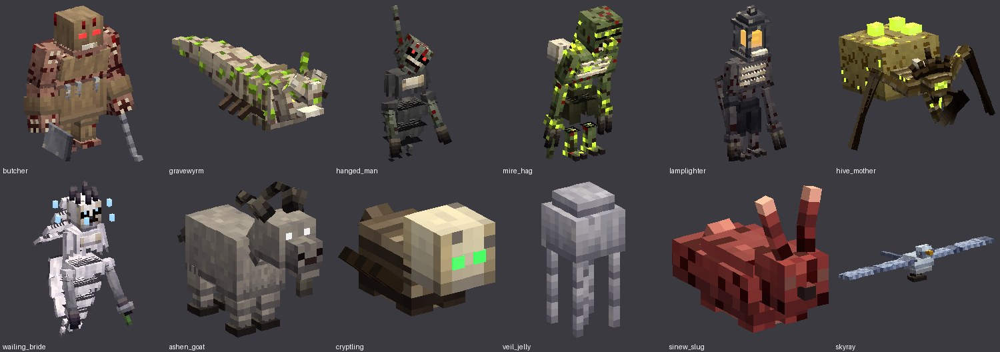

**35 landmarks**, built procedurally so no two are alike. Each has its own loot, and most have guards or a spawner:

| Where | Landmarks |
|---|---|
| Overworld | Plague Chapel, Hanging Tree, Bandit Camp, Hag's Hovel, Sunken Crypt, Bloodied Farm, Bone Pit, Ritual Circle, Ruined Watchtower, Fallen Star, Slaughterhouse, Quarantine Camp, Scarecrow Field, Lamplighter's Road |
| Hell's Paradise | Flesh Shrine, Impaler Field, Demon Forge, Cage Gallows, **Hive Nest** (Hive Mother's lair) |
| Skyfall Torn | Sky Temple, Bell Tower, Wrecked Airship, Observatory, **Bride's Chapel** (Wailing Bride's lair), Skyray Roost |
| Light's Descent | Cathedral Ruin, Mesa Outpost, Gallows Square, Abandoned Mine, Wyrm Burrow, Hangman's Hill |
| Disposed Skies | Void Obelisk, Storm Spire, Shattered Sanctum, Crystal Garden |

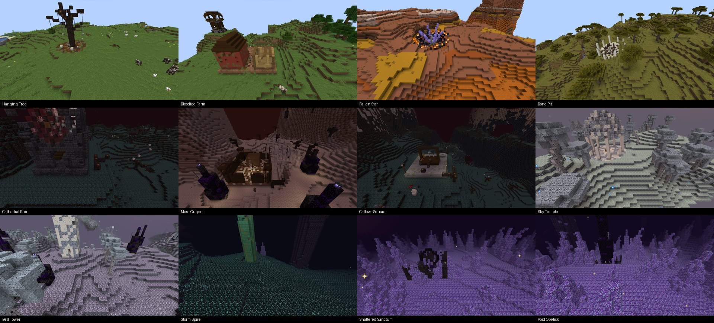
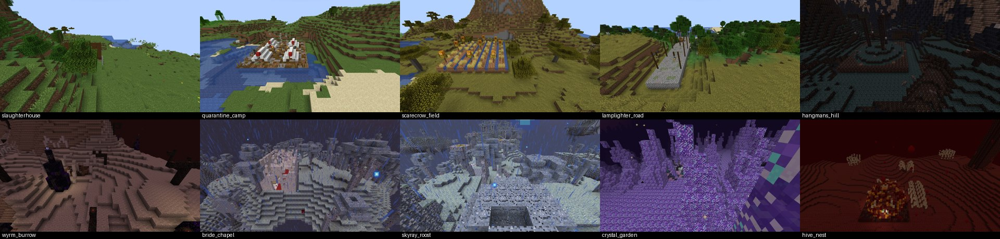

**Ores:** Necrite, Bloodstone, Voidsteel and Stardust, each with an armour set and set bonus.
Full Necrite gives night vision, full Bloodstone gives lifesteal, full Voidsteel gives
resistance, and full Stardust gives extra mana and faster regeneration.

## Combat, weapons and magic
- **Dodge** with invulnerability frames. The Phantom Step enchantment shortens the cooldown.
- **Combo chains** with DeadCraft melee weapons: each hit within 1.5 s adds 8 % damage, and the
  fifth hit is a **finisher** whose effect depends on the weapon's trait: cleave, lifesteal,
  void, starfall, reap, time or shatter.
- **Weapons:** Bone Cleaver, Bloodreaver, Voidsteel Longsword, Star Edge, Hollow Scythe, Chrono Blade, Fracture Greatsword.
- **Knives** (Bone Shiv, Ritual Dagger, Butcher Knife, Voidglass Kris): fast, every cut bleeds, and
  hits from behind do double damage. The finisher opens a deep wound and turns you briefly invisible.
- **Swords:** Grave Warden Blade and Skystone Claymore (*Sweep*: every swing cuts everything in front
  of you), Bloodmoon Katana and Sinew Saber (*Bleed*: wounds stack deeper), Static Rapier (*Storm*:
  finishers chain lightning between enemies).
- **Realistic weapon models:** every blade is built like the real thing: a tapering core with
  bevelled, honed edges, fullers, ricassos, a point, shaped crossguards with finials, leather- or
  cord-wrapped grips with ferrules and faceted pommels, all in shaded brushed steel, brass, wood
  and bone. Curved blades (katana, sabres) are smooth arcs. The guns are rebuilt the same way: an
  octagonal-barrelled revolver with a fluted cylinder, a double-barrel shotgun with a rib and bead,
  a scoped bolt-action rifle and a vented SMG with a stick magazine and wire stock.

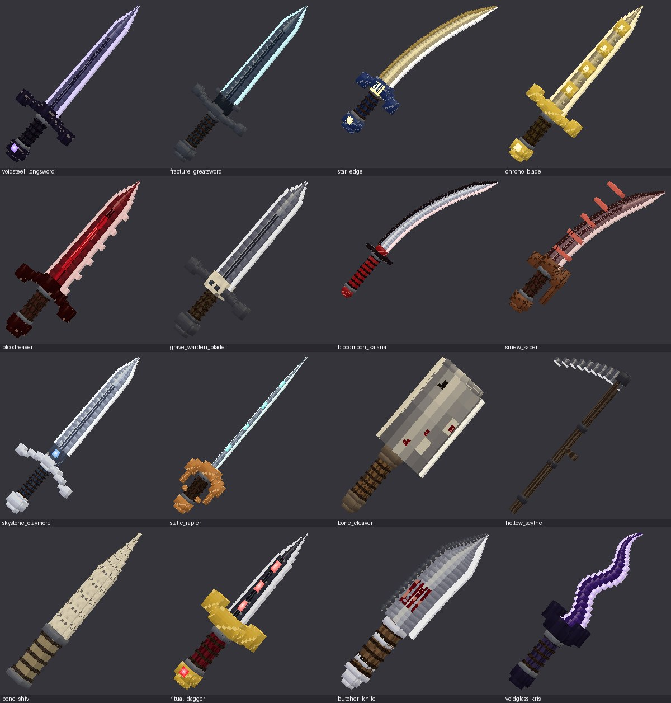
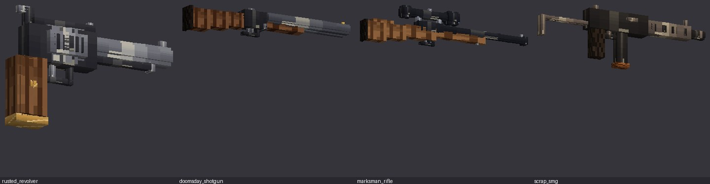
- **Guns:** Rusted Revolver, Doomsday Shotgun, Marksman Rifle, Scrap SMG. They have 3D models, use real ammo and reload, and their recoil kicks the camera.
- **Magic:** read a **Grimoire of Awakening** (bosses drop it; you can also craft it) to unlock
  mana. Then: Soul Staff (homing bolt), Ember Staff (fireball), Frost Tome (freezing nova),
  Void Tome (blink), Storm Rod (lightning), Blood Chalice (heal). Mana Tonics refill mana.
- **Enchantments:** Bloodthirst, Soul Reaper, Exorcism, Hollow Point, Quick Reload, Phantom Step, Static Ward.

## Presentation
- **Title screen:** a candle-lit crypt. The menu is a column of gothic words on the left that slide
  aside over a stroke of blood when hovered. On the altar at the right stands a live, animated 3D
  model of one of the seven bosses, turning in red light with its name and title beneath it; every
  few seconds static swallows the altar and another boss is standing there when it clears. Embers
  rise from the altar, fog crawls over the floor and the candlelight flickers.
- **Menus and GUIs:** the panorama behind every menu is the same blood-moon graveyard, painted as a
  1024px cube map. All containers (inventory, chests, furnaces, crafting, anvil, enchanting,
  brewing, villagers, hoppers, ...) are re-painted as stained, cracked bone with dark slots and
  blood drips. The menu backgrounds, separators, tabs, sliders, text fields, checkboxes, scrollers,
  hotbar, offhand slots, XP bar, crosshair and every boss bar colour are re-drawn too, and every button is re-skinned.
- **HUD:** health is a glass vial of sloshing blood and hunger a vial of bile, with a skull medallion
  between them whose eyes burn as you near death. Lost health leaves a pale "damage ghost" in the
  vial, the glass cracks under 30%, and the vial shakes when you are hit. Armour is a row of shield
  pips and mana a vial of souls. There is also a vignette, film grain, a red heartbeat pulse at low health, and bleeding edges.
- **Camera:** a slow, heavy sway when walking and a faster, tighter one when running. It leans into strafes, dips on a spring when you land, rolls when you dodge, and handles recoil and screen shake (bosses shake the screen). FOV eases in when sprinting.
- **First-person view models:** the player's own arms (skin and sleeves) hold every DeadCraft
  weapon. Guns are held in both hands, right hand on the grip and left hand under the barrel or
  around the revolver grip; **sneaking with a gun aims down the sights**, bringing the sight to the
  crosshair with a slight zoom. Blades sit in a visible hand that follows every swing. On top:
  inertia sway, bob, a lowered sprint pose and recoil kick.

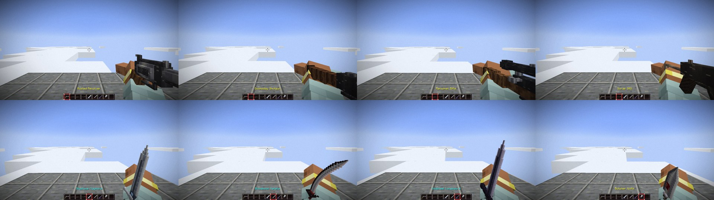

- **Gun effects:** every gun has layered sound: a supersonic crack, a body thump, its own
  mechanical action, an outdoor slap-back and a low distant report that carries far. Each gun has
  its own reload sequence (revolver gate and six rounds, shotgun break-open, rifle bolt and
  stripper clip, SMG mag swap and charging handle), and the rifle bolt and revolver hammer cycle
  after each shot. On screen: a muzzle flash at the barrel, grey gun smoke, brass casings that
  eject to the right and bounce, glowing tracers along each bullet's path, and impacts that kick
  debris out of the surface, with sparks off stone and metal.

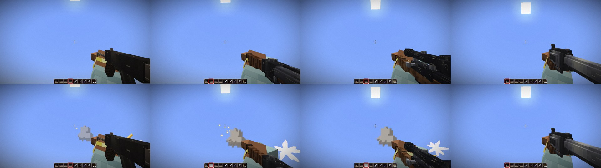
- **Player animation (third person):** walking, the pelvis bobs and sways, the torso
  counter-rotates against the legs, the arms swing as pendulums and the head stays on target;
  sprinting, the body leans into the run, the arms pump and the stride lengthens; standing still,
  the player breathes. **Swings** depend on what is in hand: knives stab and an empty hand jabs
  (the off hand guarding), heavy blades and axes are hauled overhead with both hands and chopped
  down with the whole body, swords cut a wide horizontal arc, and tools lean into the stroke.
- **Player animation (first person):** the same stab, overhead chop and arc for DeadCraft blades
  and vanilla swords and axes, with a shallower cooldown dip so the swing stays on screen.

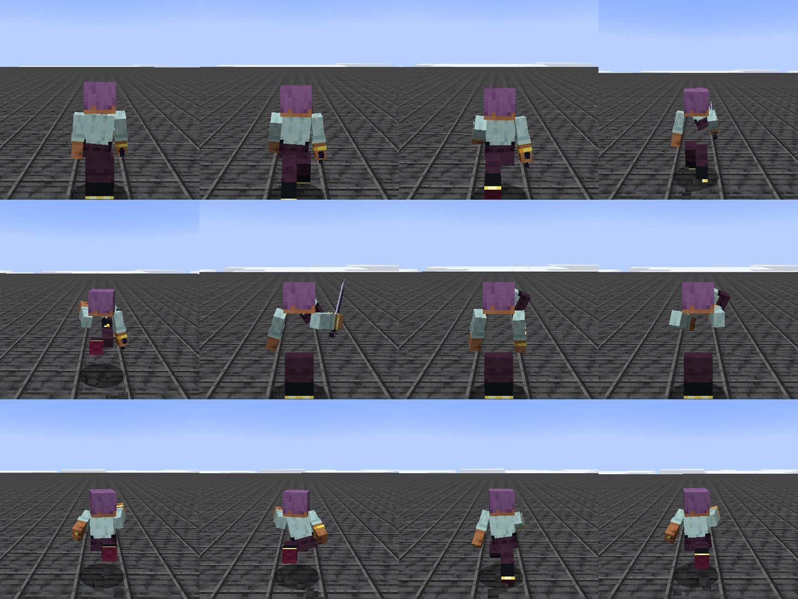
- **Sound:** 58 sound events (88 files): gear rustle per stride, running steps, breathing after long
  sprints, a low-health heartbeat, landing thuds, and every weapon, spell, creature, boss, portal and vehicle.
- **VFX:** 11 custom particles (blood, embers, souls, sparks, stars, runes, sword slashes, ash,
  frost, muzzle flash, ground shockwaves). Creatures have glowing eyes and lava cracks, and projectiles have emissive halos.

Every option is in `config/deadcraft-client.toml` (camera sway strength, film grain, HUD, title
screen, animations, movement sounds) and `deadcraft-server.toml` (voice hearing range).

## Editing the art

All art is generated from code so the project rebuilds from scratch, and every piece can be replaced:

```sh
python3 tools/gen_assets.py   # models, textures, item/block models, lang, sounds.json
python3 tools/gen_sounds.py   # 88 .ogg files (numpy + ffmpeg)
python3 tools/gen_data.py     # worldgen, structures, loot, recipes, tags, enchantments
python3 tools/validate.py     # cross-checks every reference (items, features, textures, lang)
python3 tools/preview.py out.png   # renders every creature in 3D to a contact sheet for review
```

Creature rigs also get an automatic detail pass (`rigs.detail`): kneecaps, knuckles, toe ridges,
hooves, brow ridges and cheekbones, nostrils, vertebrae down the back, joint knobs on crawler legs,
feather tips and tail tufts, sized from each bone's own box.

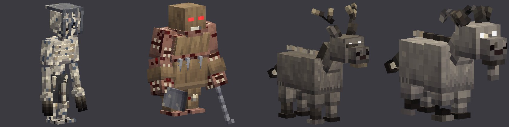

### Performance
- Bone lookups for keyframe animation are cached (vanilla searches the whole model tree per bone,
  per animation, per frame).
- The emissive eye layer draws only the bones that actually glow (`glow_parts.json`).
- Weapons use flat icons in inventories and the hotbar, and their 3D models drop every face
  hidden inside another box.
- The sky's dome and star fields are built once into GPU buffers.
- Ambient biome particles are thinner, and structure guards (other than bosses) can despawn.

**Clean textures:** creature skins are painted the way a Blockbench artist would: a few flat,
posterised tones per material, crisp structural lines (stone blocks, plates, seams, feather rows,
stitches), deliberate edge highlights and sparse, intentional details instead of per-pixel noise
(`tools/clean.py`). The Blockbench projects in `blockbench/` carry these textures and every
animation.

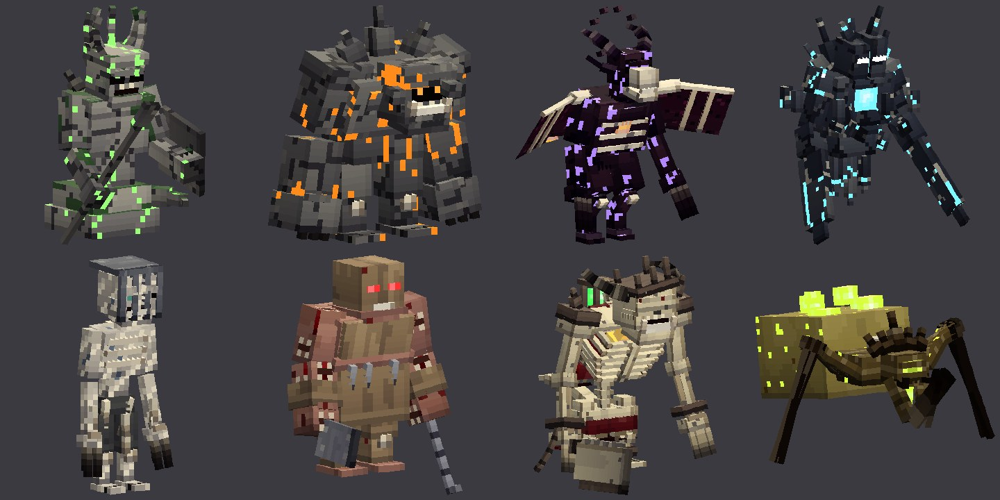

How the textures are made:
- `tools/tex.py` holds the material library: coherent value noise, Voronoi stone and crystal, fur,
  wool, feathers, chitin, cloth (with tattered hems), leather, bone, metal, void, starfield and
  ethereal materials. Its shading shifts shadows toward violet and highlights toward warm yellow,
  and adds soft ambient occlusion down each face. Materials use absolute texture coordinates, so
  patterns continue across neighbouring faces.
- `tools/rigs.py` builds every creature's skeleton: a base rig per body type (gaunt, crawler,
  wraith, brute, quadruped, critter, flyer) with jointed limbs (shin and foot, forearm and hand,
  neck and jaw), plus extras unique to each creature (back arms, rock spikes, orbiting shards,
  lanterns, flames, halos, clock hands, pendulums, masks, wings, tails, tentacle chains, ...).
- `tools/anims.py` writes the keyframe animations (walk, idle, attack, cast, fly) for each rig to
  `assets/deadcraft/neoforge/animations/entity/<id>/`, the same keyframes go into the
  `.bbmodel` files, and secondary motion (chains sway, orbits spin, flames flicker) is added per bone.
- `tools/terrain.py` paints the seamless terrain textures, the plants, the animated blood and the
  sky bodies (blood moon, shattered moon, void eye). `tools/gen_data.py` writes each dimension's
  noises, density functions (`terrain()`), surface rules, biomes and features.
- `tools/skins.py` paints each creature at twice the model's texel density: which material each body part uses, its face style
  (skull, demon, void, mask, beast, critter, bird, insect, ...) and detail decorators (stitches,
  bandages, ribs, the Hollow's empty chest, Chronos's clock, pustules, runes, glowing stripes).
  Anything that should glow goes into the `_eyes.png` emissive layer.
- `tools/icons.py` upscales each item design to 32x32, adds material detail, lights it from the
  top-left with a bevel and glints, and colours its outline from the pixels it borders.
  `tools/items3d.py` builds the 3D held models for the melee weapons and staves. `tools/art.py`
  makes blocks, gun atlases, particles and projectiles. `tools/gui.py` makes the buttons, logo and
  mod icon, and `tools/gui2.py` makes the HUD vials, panorama, title scene layers, container
  re-skins and widget sprites.

- **Entity models:** `blockbench/*.bbmodel` holds one Blockbench project per creature and vehicle,
  with its texture embedded. Open one in Blockbench ("Modded Entity" format), refine it, then export
  the Java model and texture. The project includes every animation, so you can scrub and edit them in
  the Animate tab. The game reads the NeoForge keyframe JSON written by `tools/anims.py`, so carry
  edits back there (or swap the JSON for Blockbench's exported Java keyframes). The geometry the game loads comes from
  `tools/models.py` → `ModelGeometry.java`. Keep bone names the same so the animations still apply.
- **Gun models:** `src/main/resources/assets/deadcraft/models/item/<gun>.json` are Blockbench
  "Java Block/Item" models. The Display tab tunes the first-person view model.
- **Sounds:** replace any `.ogg` under `assets/deadcraft/sounds/` with a recording of the same name.

## Project layout

```
deadcraft/
├── blockbench/            # .bbmodel projects for every creature and vehicle
├── tools/                 # asset / data / sound generators and the validator
└── src/main/java/com/deadcraft/
    ├── entity/            # DeadMob (the creature table), DeadMonster, DeadAnimal, Rotwalker, projectiles, vehicles
    ├── item/              # guns, spells, weapons, rift keys, sigils, vehicles
    ├── combat/            # dodge, combos, enchantment effects, set bonuses, status effects
    ├── world/             # dimensions, travel, hearing, structures (DeadStructure / DeadPiece, Landmark / LandmarkPiece), features
    ├── compat/voicechat/  # Simple Voice Chat plugin
    ├── client/            # title screen, HUD, camera, models, renderers, particles, sounds
    └── mixin/             # third-person walk/run animation
```
