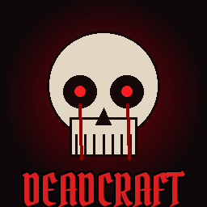
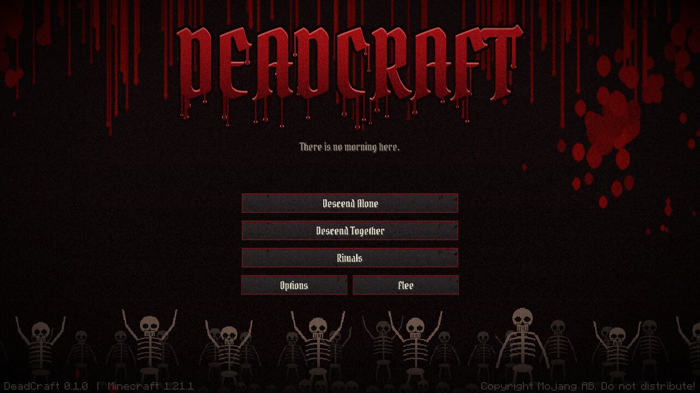
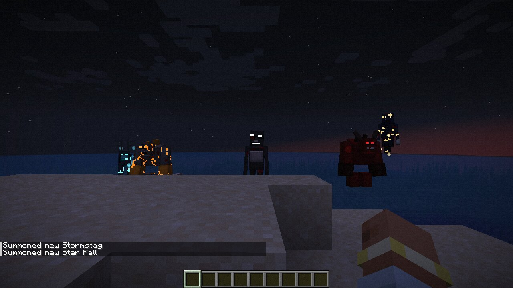
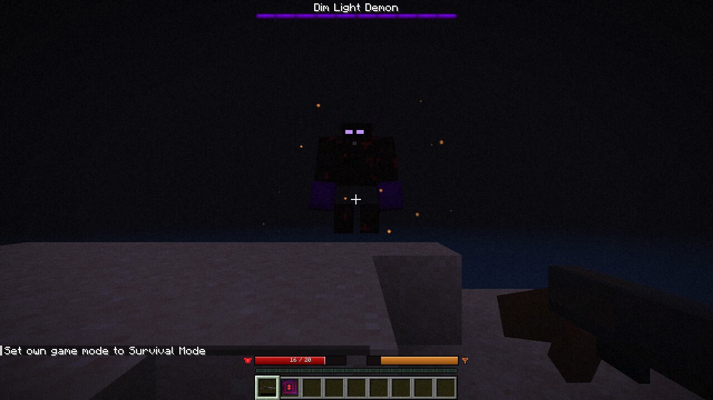

# DeadCraft



*There is no morning here.*

DeadCraft is a horror overhaul for **Minecraft 1.21.1 (NeoForge 21.1)**. Fifteen horrors hunt
the dark, five bosses wait in tombs, castles and gateways, and destroyed cities are overrun by
zombies. It adds four dimensions and five biomes, plus guns, magic, vehicles and a dodge/combo
combat system. The client side is reworked with a blood-soaked title screen, a new HUD, a
cinematic camera, walk/run animations and a full soundscape.



| | |
|---|---|
|  |  |

*Screenshots from the dev client: the title screen; The Hollow, a Blood Demon, Cracked, Star Fall,
Severed and a Stormstag; the Dim Light Demon's boss bar with the new HUD and shotgun view model.*

## Build and run

Requirements: JDK 21. Gradle downloads everything else.

```sh
cd deadcraft
./gradlew build          # → build/libs/deadcraft-0.1.0.jar (drop into your mods folder)
./gradlew runClient      # dev client
./gradlew runServer      # dev server (accept the EULA in run/eula.txt first)
```

When you first open a world, Minecraft warns that it uses experimental settings. Vanilla shows
this warning for any world with custom dimensions, and it only appears once per world.

Optional: install **[Simple Voice Chat](https://modrinth.com/plugin/simple-voice-chat)** for
proximity voice chat. DeadCraft detects it automatically, and creatures can then hear you speak.

## Controls

| Action | Default key |
|---|---|
| Dodge (i-frames, direction follows WASD) | Left Alt |
| Reload gun | R |
| Fire gun | Right-click (hold for the SMG) |
| Cast spell | Right-click with a staff, tome, rod or chalice |
| Drive vehicle | Right-click to mount. W/S throttle, A/D steer (Ruin Runner), look to fly (Sky Skiff) |
| Pick up vehicle | Sneak + punch |

## Creatures

**Hostile (15):** The Hollow (only moves when nobody is looking at it), Severed (leaps, causes
bleeding), Cracked (fires shards when struck), Depart (teleports behind you, brings darkness),
Scorched (sets everything nearby on fire), Parasite (fast leaps, infests), Illusion (spawns decoy
copies), Bandit (shoots revolvers), Bandit Captain (shotgun, calls reinforcements), The Forgotten
(hears twice as far, inflicts Dread), Wretched (spits acid), Ghosts (pass through walls, immune to
arrows), Blood Demon (lifesteal, frenzies when hurt), Star Fall (calls down falling stars),
Collapse (ground slam, explodes on death).

**Destroyed-city zombie:** Rotwalker. Unlike vanilla zombies, it doesn't burn in daylight.

**Bosses (5)**, each with a boss bar, a second phase at half health and its own trophy:
- **Fracture:** shard novas, ground slams; summons Cracked.
- **Chronos:** a slowing aura, homing time bolts and teleports. Rewinds its own health once.
- **The Skeleton:** bone volleys, raises skeleton guards, leaps at you in phase two.
- **Dim Light Demon:** darkness pulses, rains hellfire, summons Blood Demons.
- **Petrified:** looking at it slows you to a crawl. Throws boulders, slams the ground, shrugs off half of all projectile damage.

Bosses spawn in structures (the castle always has the Skeleton). You can also summon them with
**Sigils** crafted from their materials.

**Peaceful (20):** Ashgrazer, Gloomhog, Cinderhen, Marrow Ox and Duskhare drop meat you can
cook (smelt it, or kill them with fire). Also: Lantern Moth, Hush Owl, Gravecat, Wisplet,
Shellmourn, Candlewick Toad, Mossback Tortoise, Ember Fox, Veilfawn, Grimfinch, Sorrowdove,
Stormstag, Cragstrider, Lumen Beetle and Hollowfleece. Breed them with wheat, seeds, carrots or
berries.

### Hearing and proximity chat
Creatures react to sound through one system (`world/Hearing.java`):
- **Voice** (with Simple Voice Chat): the louder you speak, the further it carries. Whispering is near-silent.
- **Text chat** carries 16 blocks. Sprinting is louder than walking, and sneaking halves every noise you make.
- **Gunshots, engines, explosions and spells** are loud.

A quiet noise sends creatures to investigate. A loud or close one makes them hunt you. The Forgotten hears twice as far.

## World

| Dimension | Terrain | Biomes | Reach it with |
|---|---|---|---|
| Hell's Paradise | Nether-style caverns, lava sea | Scorched Forest | Rift Key / Gateway |
| Skyfall Torn | Floating islands | Floating Islands, Storm Field | Rift Key / Gateway |
| Light's Descent | Amplified cliffs at permanent dusk | Dark Plains, Deserted Cliffs, Storm Field | Rift Key / Gateway |
| Disposed Skies | Shattered End-like islands | Storm Field | Rift Key / Gateway |

Every DeadCraft dimension has **Portal shrines** that lead home. A Rift Key used inside a
DeadCraft dimension also takes you back to where you left the Overworld.

**Structures:** Tombs (a mausoleum over a buried crypt), Graveyards, ruined Castles, Gateways
(grand arches holding a rift to one of the dimensions), Portal shrines, and **Destroyed Cities**.
Cities are street grids of wrecked buildings in one of five styles: *burned*, *collapsed*,
*blighted*, *butchered* or *meteor-struck*. They're full of Rotwalkers, loot and wrecked cars.

**Ores:** Necrite, Bloodstone, Voidsteel and Stardust, each with an armour set and set bonus.
Full Necrite gives night vision, full Bloodstone gives lifesteal, full Voidsteel gives
resistance, and full Stardust gives extra mana and faster regeneration.

## Combat, weapons and magic
- **Dodge** with invulnerability frames. The Phantom Step enchantment shortens the cooldown.
- **Combo chains** with DeadCraft melee weapons: each hit within 1.5 s adds 8 % damage, and the
  fifth hit is a **finisher** whose effect depends on the weapon's trait: cleave, lifesteal,
  void, starfall, reap, time or shatter.
- **Weapons:** Bone Cleaver, Bloodreaver, Voidsteel Longsword, Star Edge, Hollow Scythe, Chrono Blade, Fracture Greatsword.
- **Guns:** Rusted Revolver, Doomsday Shotgun, Marksman Rifle, Scrap SMG. They have 3D models, use real ammo and reload, and their recoil kicks the camera.
- **Magic:** read a **Grimoire of Awakening** (bosses drop it; you can also craft it) to unlock
  mana. Then: Soul Staff (homing bolt), Ember Staff (fireball), Frost Tome (freezing nova),
  Void Tome (blink), Storm Rod (lightning), Blood Chalice (heal). Mana Tonics refill mana.
- **Enchantments:** Bloodthirst, Soul Reaper, Exorcism, Hollow Point, Quick Reload, Phantom Step, Static Ward.

## Presentation
- **Title screen:** a bleeding DEADCRAFT logo with chromatic glitches, a wall of skeletons with
  mouse parallax, blood running down the screen, rolling static and scanlines, a dark ambient
  score and a static hiss. The buttons are re-textured, and every vanilla button in the game is re-skinned to match.
- **HUD:** slim health, hunger, armour and mana bars. Lost health leaves a fading "damage ghost". Also a vignette, film grain, a red heartbeat pulse at low health, and bleeding edges.
- **Camera:** a slow, heavy sway when walking and a faster, tighter one when running. It leans into strafes, dips on a spring when you land, rolls when you dodge, and handles recoil and screen shake (bosses shake the screen). FOV eases in when sprinting.
- **First-person view model:** inertia sway, bob, a lowered sprint pose and recoil kick.
- **Third-person animations:** the torso counter-rotates while walking, the arms pump when
  sprinting, and every stride bounces.
- **Sound:** 58 sound events (88 files): gear rustle per stride, running steps, breathing after long
  sprints, a low-health heartbeat, landing thuds, and every weapon, spell, creature, boss, portal and vehicle.
- **VFX:** 11 custom particles (blood, embers, souls, sparks, stars, runes, sword slashes, ash,
  frost, muzzle flash, ground shockwaves). Creatures have glowing eyes and lava cracks, and projectiles have emissive halos.

Every option is in `config/deadcraft-client.toml` (camera sway strength, film grain, HUD, title
screen, animations, movement sounds) and `deadcraft-server.toml` (voice hearing range).

## Editing the art

All art is generated from code so the project rebuilds from scratch, and every piece can be replaced:

```sh
python3 tools/gen_assets.py   # models, textures, item/block models, lang, sounds.json
python3 tools/gen_sounds.py   # 88 .ogg files (numpy + ffmpeg)
python3 tools/gen_data.py     # worldgen, structures, loot, recipes, tags, enchantments
python3 tools/validate.py     # cross-checks every reference (items, features, textures, lang)
```

- **Entity models:** `blockbench/*.bbmodel` holds one Blockbench project per creature and vehicle,
  with its texture embedded. Open one in Blockbench ("Modded Entity" format), refine it, then export
  the Java model and texture. The geometry the game loads comes from `tools/models.py` →
  `ModelGeometry.java`. Keep part names the same so the animations still apply.
- **Gun models:** `src/main/resources/assets/deadcraft/models/item/<gun>.json` are Blockbench
  "Java Block/Item" models. The Display tab tunes the first-person view model.
- **Sounds:** replace any `.ogg` under `assets/deadcraft/sounds/` with a recording of the same name.

## Project layout

```
deadcraft/
├── blockbench/            # .bbmodel projects for every creature and vehicle
├── tools/                 # asset / data / sound generators and the validator
└── src/main/java/com/deadcraft/
    ├── entity/            # DeadMob (the creature table), DeadMonster, DeadAnimal, Rotwalker, projectiles, vehicles
    ├── item/              # guns, spells, weapons, rift keys, sigils, vehicles
    ├── combat/            # dodge, combos, enchantment effects, set bonuses, status effects
    ├── world/             # dimensions, travel, hearing, structures (DeadStructure / DeadPiece), features
    ├── compat/voicechat/  # Simple Voice Chat plugin
    ├── client/            # title screen, HUD, camera, models, renderers, particles, sounds
    └── mixin/             # third-person walk/run animation
```
