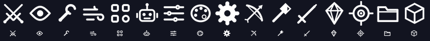
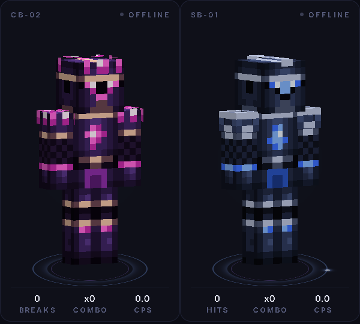
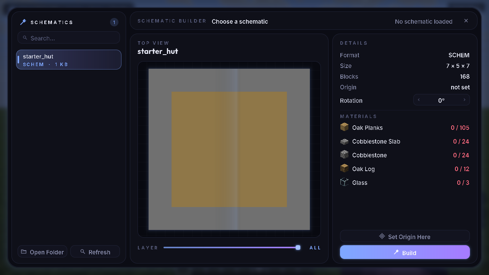
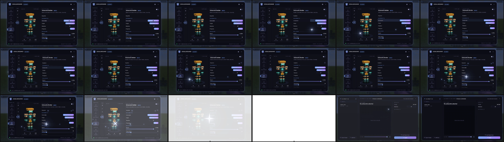
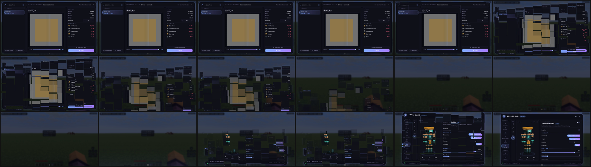

# SoulBound Client

A Fabric client for Minecraft **1.21.11**. It includes a custom title screen, the SoulBound menu and these modules:

| Tab | Module |
| --- | --- |
| Combat | **Trigger Bot**, **Aim Assist** and **Auto Hit Crystal** |
| Visual | **Custom HUD** |
| Misc | **Auto MLG** |
| Bots, PvP group | **Sword PvP Bot**, **Crystal PvP Bot** and **UHC Bot** |
| Bots, Utility group | **Schematic Builder** |

## Title screen


SoulBound replaces Minecraft's main menu with a full-screen scene:

- **Background:** two layers of silk ribbons in the accent colour drift slowly and shift with the mouse for depth. Soul sparkles and glowing motes float upward and twinkle.
- **Brand:** the SoulBound logo with a breathing glow, and the client and game version underneath.
- **Menu:** Singleplayer, Multiplayer, Realms, Minecraft Settings, Client (the SoulBound menu) and Quit Game, as plain centred text. Hovering lights an entry up with:
  - a glowing pill behind it
  - wider letter spacing
  - an underline that grows from the centre
  - arrows that slide in from both sides

  The arrow keys or Tab move between entries, and Enter or Space opens one. Items fade up one after another when the screen opens.
- **Quick Join:** a pill that joins your first saved server in one click.
- **Your character:** your skin stands in 3D on the right with a ground shadow and an accent ring. It turns toward the mouse, and you can drag it to spin it.
- **Corners:**
  - a clock and the date (top right)
  - your account (bottom left)
  - the version and a **Classic Menu** link (bottom right)

**Classic Menu** shows Minecraft's own title screen for the rest of the session, with a **SoulBound Menu** button in the corner to come back. To turn the custom title screen off permanently, use *Settings → Interface → Custom Title Screen*.

## Menu


The menu has these parts:
- a header
- a category rail split into two labelled groups: **MODULES** (Combat, Visual, Util, Movement, Misc and Bots) and **GENERAL** (Settings and Theme). The selection highlight slides between the groups. The tiles size themselves to the window, so the rail always fits; in short windows they become icon-only, with a tooltip on hover.
- module tabs show a grid of module cards with search and an A-Z / Active filter. **Left-click** a card to turn it on or off; **right-click** it for quick settings.
- Settings and Theme keep a page list and a detail panel of setting cards, including dropdowns
- a footer



The icons are one consistent line-icon family, drawn by `tools/gen_icons.py`.

**Quick settings:** right-click any module card. The bar takes about one second to open:
1. **Ignite:** a crisp four-point star settles from 45°, with a soft bloom and a thin anamorphic lens streak.
2. **Dim:** it softly dims.
3. **Collapse and bloom:** it pulls into a bright point, then releases a fine shockwave ring and particles with motion trails.
4. **Morph:** the bar grows out of the burst, from a circle to a pill to the finished panel.
5. **Reveal:** the settings fade in row by row, and a glass highlight sweeps across once.

Closing reverses it: the bar folds back into a point of light that fades out. It's accompanied by a soft amethyst chime, then the crack of an amethyst cluster. All timings follow the *Animation Speed* setting.


Settings has the Interface and Audio pages. Theme has its own tile for the accent colour and glow.

**The Bots tab uses a different layout:**
- a bot icon strip, split into **PVP** and **UTIL** groups
- a 3D preview of the bot's own skin, which you can drag to rotate, on a glowing pedestal, with live hits, combo and CPS
- a flat settings panel with checkboxes, `‹ value ›` arrow selectors and sliders


## Natural aiming (all bots, Aim Assist)

Rotation runs every rendered frame, not 20 times a second, and goes through the same path as real mouse input, so turning is smooth at any frame rate. Every aiming module has an **AIM** section:

| Setting | What it does |
| --- | --- |
| Turning | *Natural* (speed tapers as it nears the target, with limited acceleration, like a hand), *Normal* (a springy follow) or *Linear* (constant speed) |
| Aim Speed | Top turning speed, in degrees per second |
| Smoothness | Higher values ease in more gently |
| Vertical Speed | Pitch speed relative to yaw |
| Jitter | Small layered hand-tremor noise, a little stronger while turning fast |
| Overshoot | Big flicks pass the target slightly, then settle |
| Reaction Time | Delay before following the target's movement |
| Sensitivity Fix | Moves in the step sizes your mouse sensitivity allows, like real mouse input |

Bots and modules only act (swing, place or break) once the aim error is under their *Max Aim Error*. Long settings lists are divided into labelled sections.

## Bot playstyles

Every PvP bot has a **STYLE** section at the top with a *Playstyle* selector. It shapes how the bot uses your settings rather than replacing them:

| Playstyle | Sword and UHC bots | Crystal bot |
| --- | --- | --- |
| Trained | Plays exactly by your settings | Fights from your *Fight Distance* |
| Aggressive | Always chases, jump-chases long gaps, never retreats, swings slightly earlier and halves the random delay | Fights from about 3.5 blocks and accepts lethal trades |
| Untouchable | Keeps the target at the edge of reach, backs off after every hit, strafes unpredictably and retreats at 9 HP | Stays at 5.5+ blocks, takes 40% less self-damage and backs off at 8 HP |

The Cart bot follows the same idea: Aggressive lays rails closer, lights nearer and chains combos twice as fast; Untouchable keeps an extra block of room and accepts 40% less self-damage.

## Sword PvP Bot (Bots tab)


The bot has its own skin, **Soulguard**: obsidian-navy plate armour with silver trim, a soul-blue T-visor, a soul-flame crest and a silver helmet fin (`textures/entity/sword_bot.png`, generated by `tools/gen_bot_skin.py`). It's shown in the Bots tab preview.

When enabled, the Sword PvP Bot takes over movement and combat. It was rebuilt around how good players actually fight:

- **World-space movement:** it decides where to go (toward the target, around them, away from them) and then presses whichever keys match the way your head is currently facing. Because the aim is smoothed, the old key-relative movement made the bot run off at angles while its view caught up; now it always moves where it means to, and hops anything in the way.
- **Aim ahead:** it aims where the target will be (*Prediction*, in ticks) rather than where it was, at 780°/s with a 50 ms reaction by default. When a target is right on top of it, it aims at the chest instead of the closest edge.
- **Hit timing:** it swings only on a charged weapon (*Min Cooldown*) and, with *Skip I-Frames*, never into the target's invulnerability window, so no swing is wasted.
- **Spacing:** it holds an *Ideal Distance* just inside reach, steps in as the weapon finishes charging, and gives ground when the target crowds it, so it lands hits without trading.
- **Crits:** *Smart* jumps as the weapon charges so the hit lands on the way down; *Always* crits every hit.
- **Sprint Reset:** W-Tap, S-Tap or Sprint Tap after every landed hit (with *Tap Length*), so each hit carries full knockback.
- **Strafe:** Circle, Random, or Smart (jukes right after landing a hit), with *Strafe Switch* timing.
- **Defense:** *Auto Block* raises an offhand shield between swings when the target is facing you with a weapon; *Retreat Health*, *Eat Gapples* (backing away while eating) and *Auto Totem*.
- **Weapons:** *Weapon* picks the best sword or axe by damage (or keeps what you hold); *Break Shields* swaps to an axe for one hit when the target blocks.
- **Targeting:** players, hostile mobs or both within *Search Range*, by closest, lowest health or crosshair, with *FOV*, *Through Walls*, *Ignore Invisible* and *Target Lock*. It finishes a nearly dead target before switching, and skips teammates and creative players.
- **Pausing:** stops whenever a screen is open, such as chat, inventory or this menu. When it pauses or is disabled, it hands the movement keys back to your keyboard.
- **Tested:** against a vindicator (an axe mob that hits for 7–8 through iron) it won in about 2.5 seconds with four fully charged hits and took no damage. Three vindicators at once still overwhelm it in iron armour without golden apples.

**HUD:** a status card that sits below the crosshair by default and can be moved to a corner. It shows:
- the bot's state: Searching, Chasing, Engaging, Retreating or Paused
- the target's head, name and distance
- an animated health bar, with a white "ghost" that trails behind damage, a red tint at low health and an absorption strip
- a red flash on the target slot when the target is hit
- combo (it pops on each hit and resets when you take damage), total hits, swings per second and your own health

## Crystal PvP Bot (Bots tab)

The bot fights crystal PvP for you. Its preview skin is **Prism Knight**: deep violet plate armour with rose-gold trim, magenta eye slits, a crystal set in the faceplate, and crystal growths on the crown and shoulders.



- **Crystals:** places end crystals on obsidian or bedrock wherever they hurt the target most, and breaks crystals in reach that are worth it.
- **Damage maths:** it works out vanilla explosion damage, including exposure, difficulty, armour, armour toughness, Protection, Blast Protection and Resistance. A crystal is only used if it deals at least *Min Damage* to the target (or kills it) and at most *Max Self Damage* to you. *Anti Suicide* never lets a crystal kill you.
- **Build Obsidian:** when there's nowhere to place, it puts obsidian beside the target.
- **Survival:** *Auto Totem* keeps a totem in your offhand, and *Eat Gapples* eats golden apples at or below *Gapple Health*.
- **Placing:**
  - *Face Place* (with *Face Place Health*) and *Armor Breaker*: drop the minimum damage when the target is low, or any armour piece is below a set durability
  - *Predict*: accounts for where the target is moving
  - *Swap Mode*: Normal, or Swap Back to your previous slot
- **Breaking:**
  - *Anti Weakness*: swaps to a weapon when you have Weakness
  - *Inhibit*: won't re-hit the same crystal for a few ticks
- **Movement:** *Fight Distance*, *Orbit* (a slow circle while holding distance) and *Avoid Edges*, all in world space like the Sword bot. Aiming uses the natural aim settings.
- **Sword Fallback:** when no crystal is safe to use (for example without Blast Protection, or a mob right in your face), it fights with the sword instead of standing still.
- **Testing:** in Blast Protection IV netherite it built obsidian, then repeatedly brought a vindicator from 24 HP down to 1–4 HP with crystals, staying at 18–20 HP itself. Without Blast Protection, nearly every crystal exceeds the self-damage limit (about 37 HP at 4.5 blocks in plain iron), which matches real crystal PvP; that's when the sword fallback takes over.

Only one bot runs at a time; turning one on turns the others off. The bot HUD follows whichever bot is running.

## Cart PvP Bot (Bots tab)

TNT-minecart PvP. Its skin is **Demolisher**: charcoal plate, a red-and-white TNT band across the chest, an ember visor and a lit fuse on the helm.

1. **Rail:** it lays a rail under the target, or where they're heading (*Rail Spot*: Feet, Ahead or Behind, with *Predict*). It never lays one closer to you than *Min Rail Distance*, because a cart can go off the moment something bumps it.
2. **Carts:** one TNT minecart per rail, with *Carts Per Combo* rails side by side. Two carts on one rail shove each other and detonate early, so it never stacks them.
3. **Ignite:** it switches to a **Flame** bow, draws for *Bow Draw* ticks, aims along the arrow's arc at the cart, and fires. A burning arrow detonates a TNT cart instantly. It only fires when the cart is at least *Safe Distance* away and its own blast estimate (armour, toughness and Blast Protection included) is under *Max Self Damage*; *Anti Suicide* never risks a lethal blast. If that can't be met in about a second, it drops the combo.
4. **Recover:** it backs off through the blast, waits *Combo Delay*, and goes again. Between combos, or with no carts left, it fights with the sword.

It pulls rails, carts and the bow into the hotbar from your inventory as needed (TNT minecarts don't stack, so they fill the hotbar quickly). It also keeps a totem and eats golden apples. Tested in Blast Protection IV netherite: one combo killed a 24 HP vindicator outright while the bot took 0.4 damage.

## UHC Bot (Bots tab)

The Sword PvP Bot's melee, plus everything a UHC fight needs. Its skin is **Vanguard**: iron plate with gold trim and a crimson visor and tabard.
- **Bow:** at range (*Bow Min Range* to *Bow Max Range*) it draws to *Bow Charge*. It aims on the arrow's arc, with *Lead Shots* to aim ahead of moving targets, and strafes while drawing.
- **Rod:** in the mid range it hooks the target with a fishing rod for knockback, reels in, and swaps back to the sword.
- **Water Clutch:** uses Auto MLG's clutch on big falls, even when Auto MLG itself is off.
- **Survival:** golden apples and Auto Totem are on by default.

## Schematic Builder (Bots tab, Utility group)



The bot builds schematics from its own folder, `config/soulbound/schematics/`. It reads Sponge `.schem` (v2 and v3), Litematica `.litematic` and vanilla structure `.nbt` files. Two examples are copied in: **starter_hut.schem** (a small hut) and **stone_cottage.schem** (an 11×9 cottage with a gable stair roof and a 10-high lookout tower). An example you delete stays deleted. Its skin is **Architect**: a hard hat, a teal-glass visor, copper trim and a hi-vis tabard.

**Choose Schematic** opens the picker with a transition:
1. The menu shifts while a star swirls around it on a tilted 3D orbit, passing in front of and behind the window with a comet trail.
2. The star pulls to the centre and shines until the whole screen turns white.
3. The picker appears as the white dims, and the star floats away with a soft glow.



**The picker:**
- **Left:** a searchable list of your files, with *Open Folder* and *Refresh*.
- **Centre:** a shaded top-down map with a layer slider.
- **Right:**
  - format, size, block count, origin and rotation
  - a materials list showing each item's icon and how many you have against how many you need (green, amber or red)
  - *Set Origin Here* and *Build*

**Leaving the picker:** the UI crumbles into falling tiles, and the menu rebuilds itself from tiles that fly up into place.



**Building:**
- **Place from where it stands first:** every tick it places anything it can already reach (lowest layer first), so it only walks when it has to.
- **Order:** *Bottom Up* finishes each layer before the next; *Nearest* places whatever is closest. A block is only attempted once it has something to be placed against.
- **Facing:** with *Match Facing*, stairs, logs, slabs, doors, trapdoors, buttons and other directional blocks are placed the way the schematic has them. It tests the clicked face, the height of the click and which way it looks, using Minecraft's own placement rules, and turns to that direction naturally before placing. It never places one the wrong way round.
- **Usable blocks:** it prefers not to click against chests, doors, tables and the like; when it must, it sneaks first (*Sneak On Usable Blocks*) so nothing opens.
- **Clearing:** *Clear Wrong Blocks* mines anything sitting where the schematic wants something else, and *Clear Area* also clears terrain inside the build's box, top-down so sand and gravel don't fall in. It picks the fastest tool in your hotbar.
- **Scaffolding:** the pathfinder can pillar. When no spot on the ground reaches a block (a roof, a tower), the path walks to a column the schematic leaves empty, jumps and places a junk block under itself (*Scaffold Block*: Auto picks dirt, cobble or netherrack you have that the build doesn't need), and walks on from there, for example onto the roof to reach the ridge. With *Remove Scaffold* it digs the pillar back down when it leaves, and any scaffold left behind (even after a restart) is cleaned up when the build is done. *Max Pillar* limits the height.
- **Getting unstuck:** stuck means no progress toward the next waypoint (jumping on the spot doesn't count). It re-plans, and if it's stranded on its own pillar or in a hole it digs down or pillars out. A block it truly can't reach is retried later, and a single block can never stall the whole build.
- **Materials:** it moves the right block into your hotbar; in creative, *Creative Fetch* takes it from the creative inventory. Missing materials are listed, and the build carries on with everything else (*Skip Missing*).
- **Walking:** A* pathfinding with one-block step-ups, drops of up to three blocks (*Safe Drops*), no corner-cutting, and avoidance of lava, fire, water, cactus, berry bushes, powder snow and cobwebs. Movement keys follow the path in world space, whichever way the head is looking.
- **Natural movement:** the head looks along the path, glances around occasionally, and sprints on longer straights.
- **Status:** the bot card shows what it's doing ("Placing Spruce Stairs", "Scaffolding up", "Clearing Dirt"), the schematic and any missing material.
- **Saving:** the chosen schematic, origin, rotation and any standing scaffold are saved and restored next launch.
- **Tested:** it built the stone cottage completely in survival (roof stairs facing correctly on both slopes, the full tower via scaffolding) and again in creative, and recovered on its own after a creeper blew a 36-block hole in the half-built house.

**Greeting:** when another player comes within *Greet Range*, it stops completely, turns to look at them, says hi in chat with a little wave, then goes back to building. You can choose the message, and *Greet Cooldown* limits how often it greets the same player.

## Combat tab

- **Trigger Bot** (rewritten): attacks the target under your crosshair.
  - **Targets:** players, monsters, animals and others separately, invisible entities, teammates, *Ignore Blocking*, *Ignore Unarmoured* and a *Max Range*.
  - **Timing:** *Cooldown* (swing on a charged weapon) or *CPS* (a min/max click rate, for old-combat servers); a reaction delay when the crosshair first lands (*Reaction Min/Max*), with Gaussian or uniform randomness; and *Hurt Time* syncing.
  - **Hits:** *Crits* (Off, Smart or Only Crits), *Hit Chance* with real *Miss Swings* that reset your cooldown, and *Axe On Shield*.
  - **Conditions:** what you must be holding, *Require Click*, *Not While Using*, *Not In Water* and *Only On Ground*.
- **Aim Assist:** gently pulls your aim toward the nearest target inside its *FOV* and *Distance*, using the natural aim settings. A running bot takes priority over it.
- **Auto Hit Crystal:** right-click with obsidian to place it, then it swaps to a crystal, places it and hits it.
- **Auto Clicker:** clicks while you hold a mouse button, left and right separately, with min/max CPS, a *Pattern* (Jitter, Butterfly, Drag or Flat), slipped-finger *Drop Chance* and double-click *Spike Chance*. It holds still while you mine.
- **Velocity:** keeps a chosen share of horizontal and vertical knockback, separately for explosions, with a *Chance* and conditions (only on the ground, only in fights, not in water).
- **Criticals:** turns ground hits into crits, by a faked tiny hop or a real short hop, on charged hits only. It skips crystals.
- **Sprint Reset:** automatic W-tap, S-tap or sprint-tap after your hits, with length, delay and chance.
- **Auto Weapon:** swaps to your best weapon as you attack: by damage, sword, axe or DPS; an axe against raised shields, a mace when falling, and an optional switch back.
- **Auto Gapple:** eats a golden apple at a health threshold, optionally to keep Absorption up, only in fights, with enchanted or normal apples first.
- **Bow Aimbot:** while you draw a bow, crossbow or trident, aims along the arc at the target and leads moving targets (*Lead*). *Auto Release* fires once the shot is lined up and charged.
- **Hitboxes:** widens how far your crosshair counts as on a player, monster or animal.
- **Auto Pot:** throws splash healing at your feet when low (looking down naturally, then back up), and optionally re-throws Speed, Strength and Fire Resistance.

## Visual tab

- **ESP:** glowing outlines through walls for players, monsters, animals or dropped items. The colour can follow the theme, the target's team or its health (green to red), or be white.
- **Fullbright:** *Night Vision* (a client-side effect that never flickers) or *Gamma* (true colours, up to 1600%).
- **Zoom:** hold *Zoom Key* (C by default) to zoom smoothly; scroll while zoomed to go further. It can lower your sensitivity, switch on the cinematic camera and hide your hand.
- **No Hurt Cam:** removes the camera tilt when you take damage (or keeps a *Strength*), and can turn off view bobbing.
- **Low Fire:** pushes the burning overlay down your screen, or hides it.
- **Crosshair:** Cross, T, Circle, Dot or Chevron, with size, gap, thickness, centre dot, a gap that opens while moving or charging, colour, opacity, an outline, red over entities and a hit marker.
- **Target HUD:** a card for whoever you last hit: their head, name, health with a trailing "ghost" bar, distance, armour, and whether you're winning. It can sit beside or below the crosshair or in a corner, at any scale.
- **World Tweaks:** your own time of day (fixed or slowly cycling) and weather (clear, rain or thunder), client-side.
- **Hand View:** move, scale and tilt your held items, with a separate offhand position.
- **No Overlays:** hide the pumpkin and powder snow, portal, underwater, in-wall, vignette and spyglass overlays individually.
- **Hit Effects:** extra particles (crit, magic, hearts, flame, soul, blood) and a hit sound (bell, click, stick, pling, bass) on every hit.
- **Camera Tweaks:** third-person camera distance and clipping through walls.

## Util tab

- **Auto Tool:** switches to the fastest tool while you mine, can prefer Silk Touch or Fortune, skips tools about to break, and switches back when you stop.
- **Auto Eat:** eats the most filling food when hungry, or to heal when hurt; skips harmful food (unless you're starving) and golden apples unless allowed.
- **Auto Respawn:** respawns after a delay with a random extra, and can say something once you're back.
- **Chest Stealer:** shift-clicks chests and shulker boxes empty at a random human pace. It can take everything, skip junk or only take valuables, and stops when your inventory is full.
- **Anti AFK:** random jumps, glances, swings, shuffles and sneaks at a varied interval.
- **Fast Place:** shortens the right-click delay (vanilla 4 ticks), for everything or only blocks, crystals and XP.
- **Auto Armor:** equips your best armour by armour, toughness and your preferred protection. It keeps a worn elytra and avoids Curse of Binding and nearly broken pieces.
- **Hotbar Refill:** tops up hotbar stacks from your inventory when they run low.
- **Auto Reconnect:** rejoins the last server after a disconnect, with a delay, a limit on attempts and back-off.
- **Inventory Cleaner:** throws out seeds, stone junk, mob drops or extra dirt and cobble, and never touches the hotbar unless you allow it.
- **Auto Log:** leaves the server at low health (optionally only without a totem) or when a player comes near.

## Movement tab

- **Toggle Sprint:** always sprint while walking forward, optionally in every direction and while swimming.
- **Auto Walk:** walks forward hands-free, hops over single blocks, can sprint, and stops before big drops; pressing back turns it off.
- **Safe Walk:** *Safe Walk* mode holds you at block edges the way sneaking does, without slowing you. *Eagle* mode crouches for you just before an edge.
- **Scaffold:** places blocks under you as you walk, turning to each one naturally (or without turning), with *Tower* (hold jump), *Keep Y*, *Extend*, block choice, an edge sneak and built-in safe walk.
- **Speed:** *Bhop* (auto jumps with air strafing), *Strafe* (a ground boost) or *Vanilla*, with a target speed and conditions.
- **Step:** walk up full blocks (up to 2.5) without jumping.
- **Parkour:** jumps for you at the very edge of a block.
- **Inventory Move:** keep walking, jumping and sprinting with inventories (and this menu) open.
- **No Slow:** keeps your speed while eating, blocking or drawing a bow, each separately.
- **No Fall:** no fall damage on longer falls.

## Misc tab

- **Auto Totem:** refills your offhand totem after a short, randomised delay, from the hotbar or inventory, optionally only below a health threshold.
- **Middle Click Pearl:** middle-click to throw an ender pearl, wind charge, snowball, egg or firework from your hotbar (or pulled from your inventory), then switch back.
- **Auto Fish:** reels in when a fish bites after a natural reaction delay, recasts, swaps to another rod before one breaks, and recasts if nothing bites for a while.
- **Auto GG:** says gg (or your own message, with `{name}`) when a player you were fighting dies, with a delay and cooldown.
- **Death Coords:** tells you privately where (and in which dimension) you died, and can copy the coordinates.
- **Better Chat:** timestamps (24h, 12h or with seconds), hides repeated spam, and keeps up to 5000 messages.
- **Spammer:** sends up to three of your messages on a timer, in order or at random, with jitter.
- **Fake Player:** a client-side copy of you, in your gear, to practise aim on or test ESP.

## Auto MLG (Misc tab)

When you're falling at least *Min Fall* blocks, Auto MLG looks down just before you land, switches to a clutch item and places it.
- **Items:** water bucket, powder snow, cobweb, slime block or hay bale. *Auto* picks the first one you have and skips water in the Nether.
- **After landing:** it scoops the water back up, then returns your hotbar slot and view.
- **Smart Timing:** a bucket only reaches about 2.9 blocks below your feet, and a fast fall can skip that range in one tick. Smart Timing eases that one tick's fall so you always pass through the reachable range.
- **Testing:** I survived 31- and 36-block drops at full health, with the water picked back up.

## Custom HUD (Visual tab)


Each element can be switched on or off in the module's settings:

| Element | Shows |
| --- | --- |
| Watermark | SoulBound logo, FPS, ping and time |
| Module List | Active modules, longest first, sliding in and out with accent-gradient bars |
| Coordinates | XYZ, facing, and the matching Nether or Overworld coordinates |
| Keybinds | Every module with a key bound, its key, and whether it's on |
| Potions | Effect icon, level and time left (blinks in the last 10 seconds) |
| Armor | Worn armour with colour-coded durability |
| Keystrokes | W, A, S and D, left and right mouse buttons with clicks per second, and the space bar. Pressed keys light up with the accent colour. |

**Edit Layout** opens a drag-and-drop editor. Elements snap to the screen edges and the centre lines, and right-clicking an element hides or shows it. Positions are saved as fractions of the screen, so an element pushed against an edge stays there at any window size. Other settings:
- **Background** sets the opacity of the element backgrounds.
- **Hide Vanilla Effects** hides Minecraft's own effect icons while Potions is on.


## Requirements

- Minecraft 1.21.11
- Fabric Loader 0.17 or newer (built against 0.20.1)
- Fabric API (built against 0.141.6+1.21.11)
- Java 21

## Build

```bash
./gradlew build          # jar is written to build/libs/soulbound-1.0.0.jar
./gradlew runClient      # launch a dev client
```

## Using the menu

| Action | Input |
| --- | --- |
| Open or close the menu | `Right Shift` (change it in Settings → Interface → Menu Key) |
| Change accent colour or glow | Theme (GENERAL) |
| Move HUD elements | Visual → Custom HUD → Edit Layout |
| Search modules | Click the search box, or press `/` |
| Toggle a module | Left-click its card |
| Quick settings for a module | Right-click its card |
| Change a `‹ value ›` setting | Click the left half to go back, the right half to go forward |
| Rebind a key | Click the keybind chip, then press a key (`Esc` or `Backspace` clears it) |

Settings are saved to `config/soulbound.json`.

## How the menu is drawn

- **Perfectly round edges.** `Render2D` converts GUI coordinates to real framebuffer pixels. It draws corners from anti-aliased disc, ring and glow textures generated by `ShapeCache`.
- **Texture sizes:** sizes snap to a small set of steps and are drawn slightly scaled, so animated shapes reuse a handful of textures instead of creating one per frame. Textures unused for 15 seconds are released.
- **Soft outer glow.** A procedurally generated falloff texture is 9-sliced around any rounded rectangle. The window glow breathes slowly and follows the accent colour.
- **Custom fonts.** Inter is used for body text and labels, and Outfit for the brand and titles. They load through Minecraft's TTF font providers in `assets/soulbound/font/`.
- **Sound effects.** Each interface sound is a physical model of a small object, not a tone:
  - a fingertip on a soft-touch key (hover)
  - a mouse switch, with its press and quieter release (click)
  - a latching toggle that thocks on and lets go off
  - a sliding panel that swishes open with a light glass tap, and shuts with a soft tuck
  - slider detents and keyboard taps
  - a small glass struck with a soft mallet, shimmering as two near-identical modes beat (the quick-settings shine), and a soft bloom of air for its burst

  Every sound is built from a millisecond contact transient, a few damped inharmonic resonances and a tiny room, and rendered in three slightly different takes that Minecraft picks between at random. `tools/gen_ui_sounds.py` regenerates them. The sounds aren't added to the sound registry, so the client still works on servers without the mod.
- **Animation.** All motion is frame-rate independent:
  - the selection tile slides and its edge marker glows
  - the A-Z / Active control slides
  - switches use an eased knob
  - clicks ripple
  - the selected row has a shimmer sweep
  - content fades in when you switch pages
  - the window opens with a scale-in and closes with a scale-out
- **Accent themes.** Soul, Violet, Frost and Ember.

## Adding a module

```java
public final class Example extends Module {
    private final NumberSetting speed = add(new NumberSetting("Speed", "How fast", 5, 0, 10, 0.1));
    private final ModeSetting mode = add(new ModeSetting("Mode", "Behaviour", "Normal", "Normal", "Fast"));
    private final BoolSetting flag = add(new BoolSetting("Flag", "Something", true));

    public Example() { super("Example", "What it does.", Category.UTIL); }

    @Override public void onTick() { /* runs every client tick while enabled */ }
}
```

Then call `register(new Example());` in `ModuleManager.init()`. Settings can also be a `TextSetting` (a one-line text box: click it, type, Enter to finish; Ctrl+V pastes), a `KeybindSetting`, an `ActionSetting` (a button) or a `HeaderSetting` (a section title). Implement `HudModule` to draw on the HUD while the module is on. The menu creates the list row, the switch, the keybind field and all the parameter controls automatically. Override `getTag()`, `getBadge()` and `getIcon()` to customise the header and the bots strip; any module in `Category.BOTS` appears in the Bots view.

## Assets

- `tools/gen_icons.py` regenerates the interface icons.
- `tools/gen_assets.py [logo]` rebuilds the mod icon from a logo image.
- `tools/gen_example_schem.py` regenerates the bundled starter hut and stone cottage schematics.
- `tools/gen_ui_sounds.py` regenerates the interface sounds (needs numpy and ffmpeg with libvorbis).
- `tools/gen_bot_skin.py` regenerates all five bot skins. Each face is a hand-designed pixel map. Side and back faces are shaded one tone darker and top faces one tone lighter, for consistent top-down lighting.
- `tools/gen_title_assets.py` regenerates the title screen's silk background and sparkle.
- The Inter and Outfit fonts use the SIL Open Font License. The licence texts are in `src/main/resources/licenses/`.
