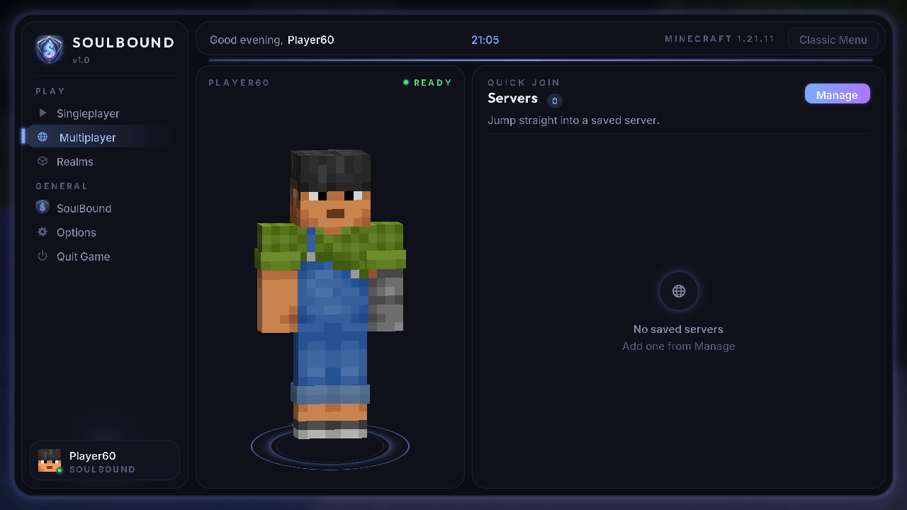
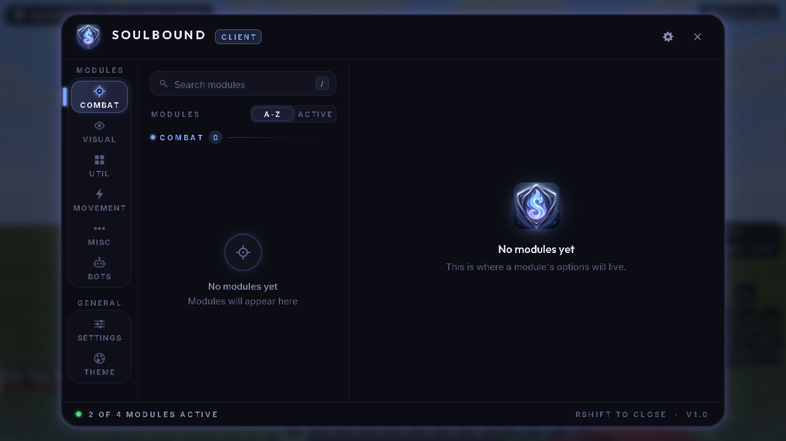
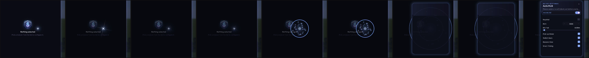
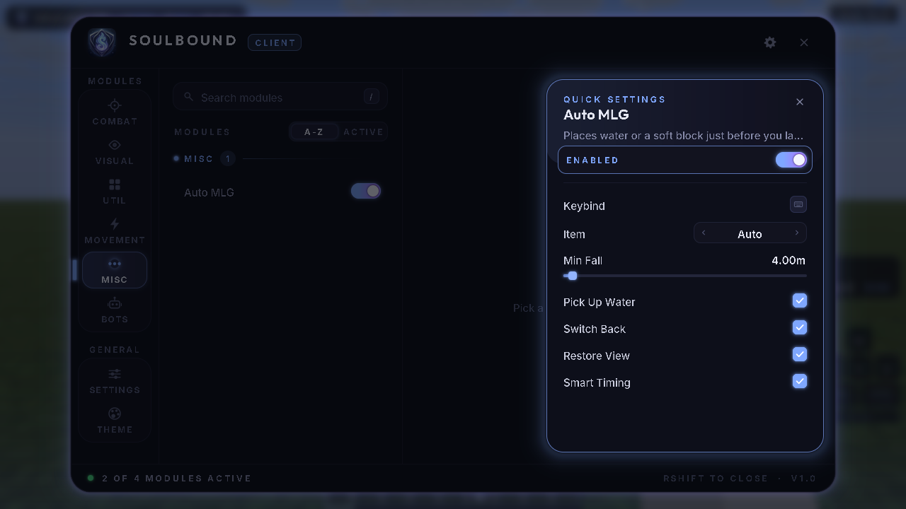
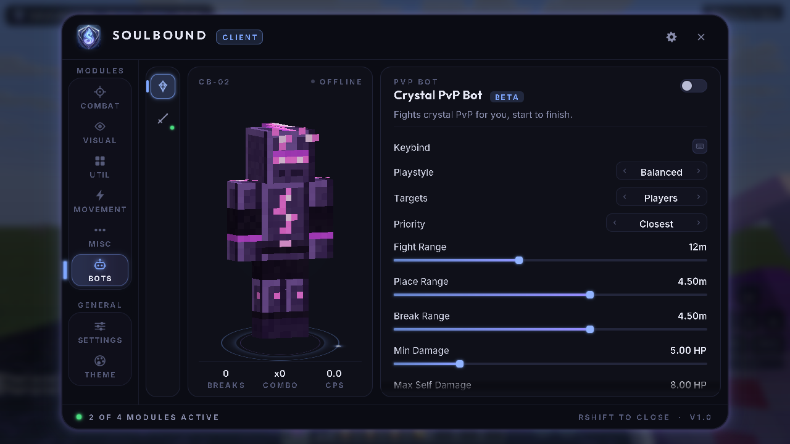
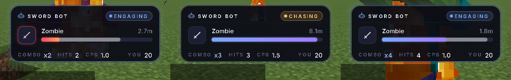
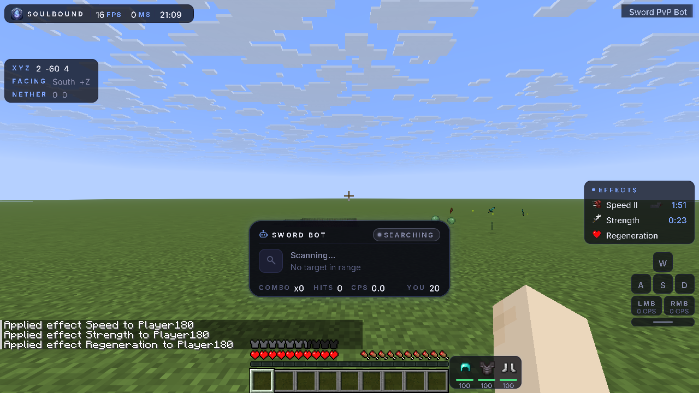
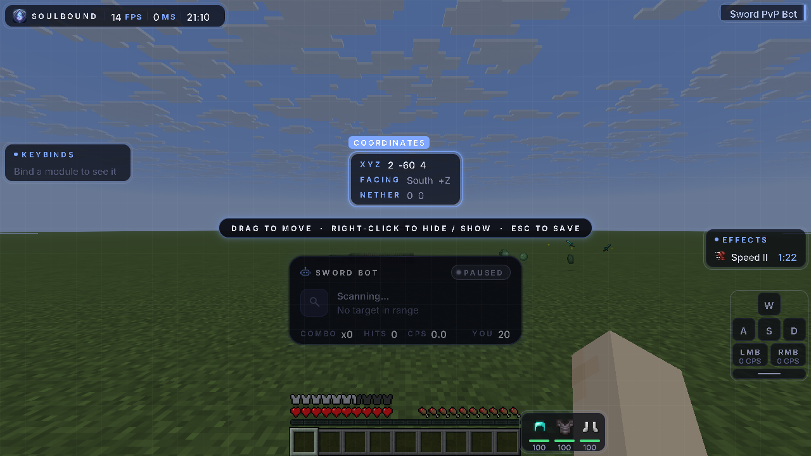

# SoulBound Client

A Fabric client for Minecraft **1.21.11**. It includes a custom title screen, the SoulBound menu and these modules:

| Tab | Module |
| --- | --- |
| Visual | **Custom HUD** |
| Misc | **Auto MLG** |
| Bots | **Sword PvP Bot** and **Crystal PvP Bot** |

## Title screen



SoulBound replaces Minecraft's main menu with a full-screen scene:

- **Background:** two layers of silk ribbons in the accent colour drift slowly and shift with the mouse for depth. Soul sparkles and glowing motes float upward and twinkle.
- **Brand:** the SoulBound logo with a breathing glow, and the client and game version underneath.
- **Menu:** Singleplayer, Multiplayer, Realms, Minecraft Settings, Client (the SoulBound menu) and Quit Game, as plain centred text. Hovering lights an entry up with:
  - a glowing pill behind it
  - wider letter spacing
  - an underline that grows from the centre
  - arrows that slide in from both sides

  The arrow keys or Tab move between entries, and Enter or Space opens one. Items fade up one after another when the screen opens.
- **Quick Join:** a pill that joins your first saved server in one click.
- **Your character:** your skin stands in 3D on the right with a ground shadow and an accent ring. It turns toward the mouse, and you can drag it to spin it.
- **Corners:**
  - a clock and the date (top right)
  - your account (bottom left)
  - the version and a **Classic Menu** link (bottom right)

**Classic Menu** shows Minecraft's own title screen for the rest of the session, with a **SoulBound Menu** button in the corner to come back. To turn the custom title screen off permanently, use *Settings → Interface → Custom Title Screen*.

## Menu



The menu has these parts:
- a header
- a category rail split into two labelled groups: **MODULES** (Combat, Visual, Util, Movement, Misc and Bots) and **GENERAL** (Settings and Theme). The selection highlight slides between the groups.
- a searchable module list with an A-Z / Active filter
- a detail panel of setting cards, including dropdowns
- a footer

**Quick settings:** right-click any module in a list. A star appears and shines, dims, then bursts in a flash with a shockwave and sparks. A settings bar grows out of the burst, showing the module's switch, keybind and every setting. Click outside it, press `Esc` or press its × to close it; it shrinks back into a fading star.




Settings has the Interface and Audio pages. Theme has its own tile for the accent colour and glow.

**The Bots tab uses a different layout:**
- a bot icon strip
- a 3D preview of the bot's own skin, which you can drag to rotate, on a glowing pedestal, with live hits, combo and CPS
- a flat settings panel with checkboxes, `‹ value ›` arrow selectors and sliders



## Sword PvP Bot (Bots tab)



The bot has its own skin, a dark-steel soul knight with a glowing visor (`textures/entity/sword_bot.png`, generated by `tools/gen_bot_skin.py`). It's shown in the Bots tab preview.

When enabled, the Sword PvP Bot takes over movement and combat:

- **Targeting:** picks players, hostile mobs or both within *Search Range*. It sorts by closest, lowest health or nearest to the crosshair, and skips teammates and creative players. It only targets entities you can see unless *Through Walls* is on.
- **Aiming:** turns toward the target's hitbox, limited by *Turn Speed*, and eases into the last few degrees.
- **Movement:**
  - *Chase*: sprints toward the target
  - *Strafe*: circles or moves side to side at random
  - *W-Tap*: resets sprint after each hit for extra knockback
  - *Jump Crits*: jumps and hits on the way down
  - *Retreat Health*: backs off at low health
- **Hitting:** swings only when the sword is fully charged and the target is within *Attack Range*. Range is measured from your eyes to the hitbox, the same way the server checks it.
- **Auto Sword:** switches to the best sword in your hotbar.
- **Pausing:** stops whenever a screen is open, such as chat, inventory or this menu. When it pauses or is disabled, it hands the movement keys back to your keyboard.

**HUD:** a status card that sits below the crosshair by default and can be moved to a corner. It shows:
- the bot's state: Searching, Chasing, Engaging, Retreating or Paused
- the target's head, name and distance
- an animated health bar, with a white "ghost" that trails behind damage, a red tint at low health and an absorption strip
- a red flash on the target slot when the target is hit
- combo (it pops on each hit and resets when you take damage), total hits, swings per second and your own health

## Crystal PvP Bot (Bots tab)

The bot fights crystal PvP for you. Its preview skin is a violet crystal knight with magenta shards.

- **Crystals:** places end crystals on obsidian or bedrock wherever they hurt the target most, and breaks crystals in reach that are worth it.
- **Damage maths:** it works out vanilla explosion damage, including exposure, difficulty, armour, armour toughness, Protection, Blast Protection and Resistance. A crystal is only used if it deals at least *Min Damage* to the target (or kills it) and at most *Max Self Damage* to you. *Anti Suicide* never lets a crystal kill you.
- **Build Obsidian:** when there's nowhere to place, it puts obsidian beside the target.
- **Survival:** *Auto Totem* keeps a totem in your offhand, and *Eat Gapples* eats golden apples at or below *Gapple Health*.
- **Playstyle:** Terminator fights from about 3.5 blocks and accepts lethal trades; Balanced stays at about 4.5; Safe stays at about 5.5 and takes less self-damage.
- **Other settings:** place and break range, place and break delay, turn speed, targets, priority and through walls.
- **Testing:** in a test fight it killed a 60 HP husk with two crystals while I took about 5 damage in Blast Protection IV netherite. Without Blast Protection, nearly every crystal would exceed the self-damage limit, which matches real crystal PvP.

Only one bot runs at a time; turning one on turns the others off. The bot HUD follows whichever bot is running.

## Auto MLG (Misc tab)

When you're falling at least *Min Fall* blocks, Auto MLG looks down just before you land, switches to a clutch item and places it.
- **Items:** water bucket, powder snow, cobweb, slime block or hay bale. *Auto* picks the first one you have and skips water in the Nether.
- **After landing:** it scoops the water back up, then returns your hotbar slot and view.
- **Smart Timing:** a bucket only reaches about 2.9 blocks below your feet, and a fast fall can skip that range in one tick. Smart Timing eases that one tick's fall so you always pass through the reachable range.
- **Testing:** I survived 31- and 36-block drops at full health, with the water picked back up.

## Custom HUD (Visual tab)



Each element can be switched on or off in the module's settings:

| Element | Shows |
| --- | --- |
| Watermark | SoulBound logo, FPS, ping and time |
| Module List | Active modules, longest first, sliding in and out with accent-gradient bars |
| Coordinates | XYZ, facing, and the matching Nether or Overworld coordinates |
| Keybinds | Every module with a key bound, its key, and whether it's on |
| Potions | Effect icon, level and time left (blinks in the last 10 seconds) |
| Armor | Worn armour with colour-coded durability |
| Keystrokes | W, A, S and D, left and right mouse buttons with clicks per second, and the space bar. Pressed keys light up with the accent colour. |

**Edit Layout** opens a drag-and-drop editor. Elements snap to the screen edges and the centre lines, and right-clicking an element hides or shows it. Positions are saved as fractions of the screen, so an element pushed against an edge stays there at any window size. Other settings:
- **Background** sets the opacity of the element backgrounds.
- **Hide Vanilla Effects** hides Minecraft's own effect icons while Potions is on.



## Requirements

- Minecraft 1.21.11
- Fabric Loader 0.17 or newer (built against 0.20.1)
- Fabric API (built against 0.141.6+1.21.11)
- Java 21

## Build

```bash
./gradlew build          # jar is written to build/libs/soulbound-1.0.0.jar
./gradlew runClient      # launch a dev client
```

## Using the menu

| Action | Input |
| --- | --- |
| Open or close the menu | `Right Shift` (change it in Settings → Interface → Menu Key) |
| Change accent colour or glow | Theme (GENERAL) |
| Move HUD elements | Visual → Custom HUD → Edit Layout |
| Search modules | Click the search box, or press `/` |
| Toggle a module | Click its switch |
| Quick settings for a module | Right-click its row |
| Change a `‹ value ›` setting | Click the left half to go back, the right half to go forward |
| Rebind a key | Click the keybind chip, then press a key (`Esc` or `Backspace` clears it) |

Settings are saved to `config/soulbound.json`.

## How the menu is drawn

- **Perfectly round edges.** `Render2D` converts GUI coordinates to real framebuffer pixels. It draws corners from anti-aliased disc and ring textures that `ShapeCache` generates at that exact pixel size, so curves stay smooth at every GUI scale.
- **Soft outer glow.** A procedurally generated falloff texture is 9-sliced around any rounded rectangle. The window glow breathes slowly and follows the accent colour.
- **Custom fonts.** Inter is used for body text and labels, and Outfit for the brand and titles. They load through Minecraft's TTF font providers in `assets/soulbound/font/`.
- **Sound effects.** There are separate sounds for hover, click, toggle on and off, open, close, slider ticks and typing. `tools/gen_assets.py` synthesises them. They are not added to the sound registry, so the client still works on servers that don't have the mod.
- **Animation.** All motion is frame-rate independent:
  - the selection tile slides and its edge marker glows
  - the A-Z / Active control slides
  - switches use an eased knob
  - clicks ripple
  - the selected row has a shimmer sweep
  - content fades in when you switch pages
  - the window opens with a scale-in and closes with a scale-out
- **Accent themes.** Soul, Violet, Frost and Ember.

## Adding a module

```java
public final class Example extends Module {
    private final NumberSetting speed = add(new NumberSetting("Speed", "How fast", 5, 0, 10, 0.1));
    private final ModeSetting mode = add(new ModeSetting("Mode", "Behaviour", "Normal", "Normal", "Fast"));
    private final BoolSetting flag = add(new BoolSetting("Flag", "Something", true));

    public Example() { super("Example", "What it does.", Category.UTIL); }

    @Override public void onTick() { /* runs every client tick while enabled */ }
}
```

Then call `register(new Example());` in `ModuleManager.init()`. The menu creates the list row, the switch, the keybind field and all the parameter controls automatically. Override `getTag()`, `getBadge()` and `getIcon()` to customise the header and the bots strip; any module in `Category.BOTS` appears in the Bots view.

## Assets

- `tools/gen_assets.py [logo] [--sounds]` regenerates the icons. Pass the logo image to rebuild the mod icon, and `--sounds` to rebuild the sound effects.
- `tools/gen_bot_skin.py` regenerates both bot skins.
- `tools/gen_fx_sounds.py` regenerates the shine and burst sounds used by quick settings.
- `tools/gen_title_assets.py` regenerates the title screen's silk background and sparkle.
- The Inter and Outfit fonts use the SIL Open Font License. The licence texts are in `src/main/resources/licenses/`.
