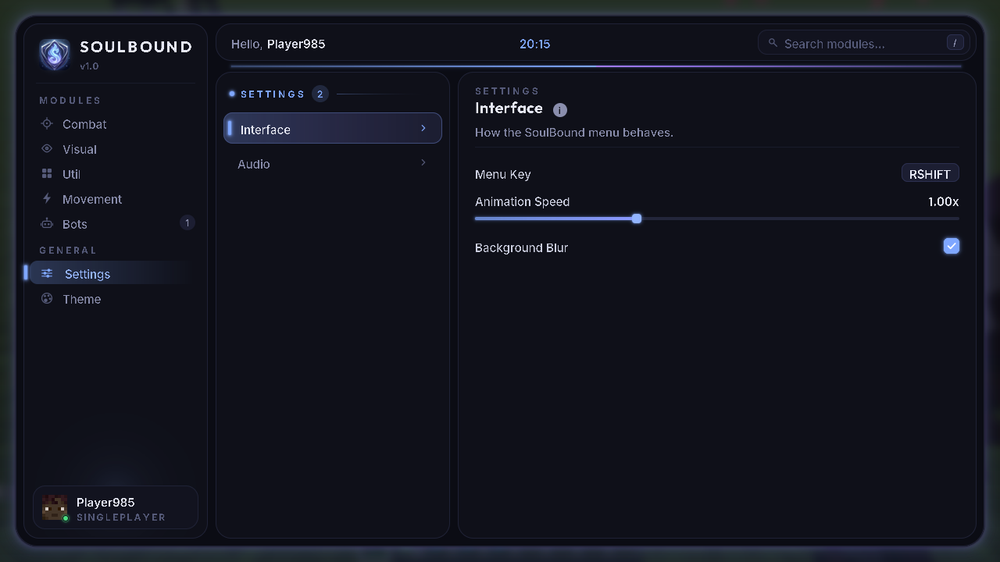

# SoulBound Client

A Fabric client for Minecraft **1.21.11**. This build contains the menu, the module and settings framework, and one module: the **Sword Bot** in the Bots tab.




`docs/gui-module-example.png` shows how a module page looks. It used temporary test modules that are not in this build.

## Sword Bot (Bots tab)


When enabled, the Sword Bot takes over movement and combat:

- **Targeting:** picks players, hostile mobs or both within *Search Range*. It sorts by closest, lowest health or nearest to the crosshair, and skips teammates and creative players. It only targets entities you can see unless *Through Walls* is on.
- **Aiming:** turns toward the target's hitbox, limited by *Turn Speed*, and eases into the last few degrees.
- **Movement:**
  - *Chase*: sprints toward the target
  - *Strafe*: circles or moves side to side at random
  - *W-Tap*: resets sprint after each hit for extra knockback
  - *Jump Crits*: jumps and hits on the way down
  - *Retreat Health*: backs off at low health
- **Hitting:** swings only when the sword is fully charged and the target is within *Attack Range*. Range is measured from your eyes to the hitbox, the same way the server checks it.
- **Auto Sword:** switches to the best sword in your hotbar.
- **Pausing:** stops whenever a screen is open, such as chat, inventory or this menu. When it pauses or is disabled, it hands the movement keys back to your keyboard.

**HUD:** a status card that sits below the crosshair by default and can be moved to a corner. It shows:
- the bot's state: Searching, Chasing, Engaging, Retreating or Paused
- the target's head, name and distance
- an animated health bar, with a white "ghost" that trails behind damage, a red tint at low health and an absorption strip
- a red flash on the target slot when the target is hit
- combo (it pops on each hit and resets when you take damage), total hits, swings per second and your own health

## Requirements

- Minecraft 1.21.11
- Fabric Loader 0.17 or newer (built against 0.20.1)
- Fabric API (built against 0.141.6+1.21.11)
- Java 21

## Build

```bash
./gradlew build          # jar is written to build/libs/soulbound-1.0.0.jar
./gradlew runClient      # launch a dev client
```

## Using the menu

| Action | Input |
| --- | --- |
| Open or close the menu | `Right Shift` (change it in Settings → Interface → Menu Key) |
| Search modules | Click the search box, or press `/` |
| Toggle a module | Click its switch, or right-click the row |
| Rebind a key | Click the keybind chip, then press a key (`Esc` or `Backspace` clears it) |

Settings are saved to `config/soulbound.json`.

## How the menu is drawn

- **Perfectly round edges.** `Render2D` converts GUI coordinates to real framebuffer pixels. It draws corners from anti-aliased disc and ring textures that `ShapeCache` generates at that exact pixel size, so curves stay smooth at every GUI scale.
- **Soft outer glow.** A procedurally generated falloff texture is 9-sliced around any rounded rectangle. The window glow breathes slowly and follows the accent colour.
- **Custom fonts.** Inter is used for body text and labels, and Outfit for the brand and titles. They load through Minecraft's TTF font providers in `assets/soulbound/font/`.
- **Sound effects.** There are separate sounds for hover, click, toggle on and off, open, close, slider ticks and typing. `tools/gen_assets.py` synthesises them. They are not added to the sound registry, so the client still works on servers that don't have the mod.
- **Animation.** All motion is frame-rate independent:
  - the selection tile slides and its edge marker glows
  - the A-Z / Active control slides
  - switches use an eased knob
  - clicks ripple
  - the selected row has a shimmer sweep
  - content fades in when you switch pages
  - the window opens with a scale-in and closes with a scale-out
- **Accent themes.** Soul, Violet, Frost and Ember.

## Adding a module

```java
public final class Example extends Module {
    private final NumberSetting speed = add(new NumberSetting("Speed", "How fast", 5, 0, 10, 0.1));
    private final ModeSetting mode = add(new ModeSetting("Mode", "Behaviour", "Normal", "Normal", "Fast"));
    private final BoolSetting flag = add(new BoolSetting("Flag", "Something", true));

    public Example() { super("Example", "What it does.", Category.UTIL); }

    @Override public void onTick() { /* runs every client tick while enabled */ }
}
```

Then call `register(new Example());` in `ModuleManager.init()`. The menu creates the list row, the switch, the keybind field and all the parameter controls automatically.

## Assets

- `tools/gen_assets.py <logo>` regenerates the icons, the mod icon and the sound effects.
- The Inter and Outfit fonts use the SIL Open Font License. The licence texts are in `src/main/resources/licenses/`.
